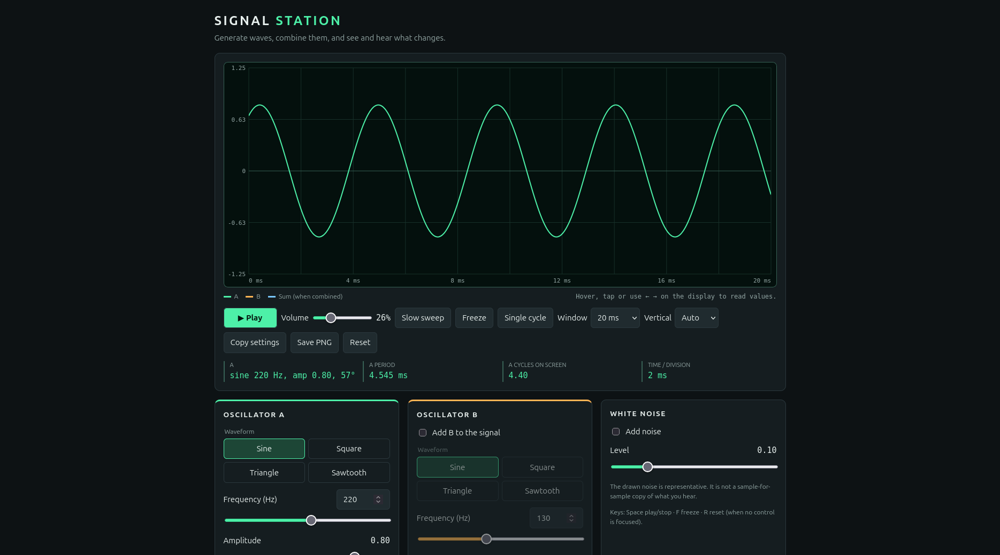

# Signal Station

An interactive browser lab for generating, combining, hearing, and exploring signals.

[**Open Signal Station**](https://signalstation.vercel.app)

## Explore signals

- **Build a signal:** Choose sine, square, triangle, or sawtooth for oscillator A. Adjust its
  frequency from 20–2000 Hz, amplitude, and phase. Turn on oscillator B to combine a second
  wave, or add white noise.
- **Read the waveform:** Set the display window from 5 ms to 1 s, fit a single cycle, or use
  slow sweep to watch the trace move. Freeze the display and hover, tap, or use the arrow keys
  on the scope to inspect values with the cursor.
- **Experiment:** Try eight presets exploring frequency, beats, interference, harmonics, and
  noise. The sampling panel compares an ideal sine wave with instantaneous samples and the
  lowest-frequency sine that passes through those samples.
- **Keep or reset a setup:** Copy the current settings, save the scope trace as a PNG, or reset
  to the defaults. Settings are saved locally in your browser.

Keyboard shortcuts: **Space** plays or stops audio, **F** freezes the display, and **R** resets
the app when a control is not focused.

## Signal model

The scope draws the mathematical signal, not a recording of the audio output. Oscillator B and
noise are included only when enabled:

`x(t) = x_A(t) + x_B(t) + n(t)`, where `x_i(t) = A_i · wave(f_i · t + φ_i)`.

Here, `A` is amplitude, `f` is frequency, and `φ` is phase. Frequency is measured in hertz
(cycles per second); the period is the time for one cycle, `T = 1 / f`. Signals add point by
point: waves in phase reinforce, while equal waves 180° apart cancel. Two close frequencies
produce beats at `|f₁ − f₂|`.

The sampling panel is a visual illustration: it uses ideal instantaneous samples and does not
model converter filters or quantization. It shows how sampling below twice a signal's frequency
can make the signal appear to have a different, lower frequency (aliasing).

## Hearing the signal

Audio starts only after you press **Play** or **Space**. Each oscillator uses a band-limited
wave built from up to 256 harmonics. When you change a waveform, phase, or on/off state, the
audio crossfades to the new sound over 30 ms. After a frequency-slider drag, both oscillators
restart together when you release it to restore their relative phase.

The output is scaled to leave headroom. The volume control starts at 30% of its range, and
output gain is capped. Stopping audio fades it out and suspends the audio context; leaving the
page closes it.

## Limitations

- Band-limited audio differs slightly from the ideal drawn square and sawtooth waves.
- The displayed noise is representative; it is not a sample-for-sample copy of the sound.
- Relative phase is restored after a frequency-slider drag, not continuously while dragging.
- The sampling experiment omits real-world filters and quantization.
- Low frequencies may be difficult to hear on small speakers.
- There is no stereo, filtering, FFT view, or audio-file export.
